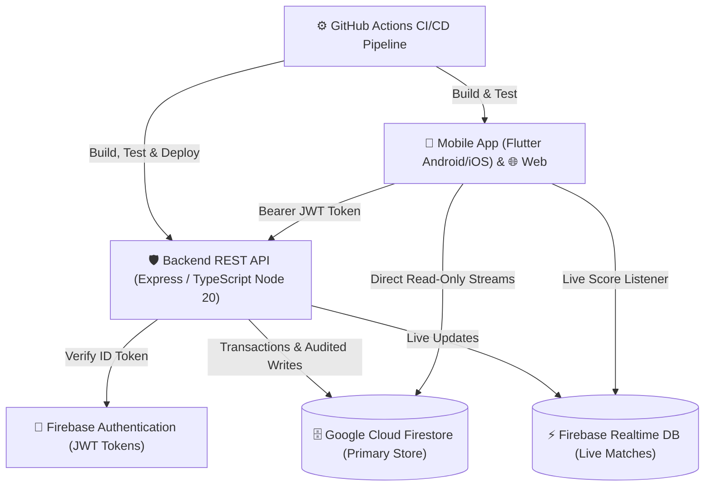

# ⚽ Ballhub - Hệ Thống Quản Lý Bóng Đá Toàn Diện

[](https://github.com/HNTDat0805/ballhub/actions/workflows/ci-backend.yml)
[](https://github.com/HNTDat0805/ballhub/actions/workflows/ci-frontend.yml)
[](https://github.com/HNTDat0805/ballhub/actions/workflows/build-android.yml)
[](https://github.com/HNTDat0805/ballhub/actions/workflows/deploy-firebase.yml)
[](https://flutter.dev)
[](https://nodejs.org)
[](https://www.typescriptlang.org)
[](https://firebase.google.com)

**Ballhub** là nền tảng quản lý bóng đá phong trào và bán chuyên nghiệp toàn diện, tích hợp đầy đủ các phân hệ: **Tổ chức giải đấu, Quản lý đội bóng, Lịch thi đấu & Bảng xếp hạng trực tiếp, Đặt sân bóng và Cáp kèo tìm đối giao lưu**. Ứng dụng được xây dựng trên kiến trúc hướng dịch vụ an toàn (API-First), hỗ trợ đa nền tảng (Android, iOS, Web).

---

## 📑 Mục Lục
- [1. Tính Năng Nổi Bật](#1-tính-năng-nổi-bật)
- [2. Kiến Trúc Hệ Thống & Công Nghệ](#2-kiến-trúc-hệ-thống--công-nghệ)
- [3. Cấu Trúc Thư Mục](#3-cấu-trúc-thư-mục)
- [4. Yêu Cầu Môi Trường (Prerequisites)](#4-yêu-cầu-môi-trường-prerequisites)
- [5. Hướng Dẫn Cài Đặt & Chạy Dự Án](#5-hướng-dẫn-cài-đặt--chạy-dự-án)
  - [Khởi chạy Backend API (Cloud Functions)](#khởi-chạy-backend-api-cloud-functions)
  - [Khởi chạy Mobile / Web Frontend (Flutter)](#khởi-chạy-mobile--web-frontend-flutter)
- [6. An Ninh & Kiểm Soát Truy Cập (Security & RBAC)](#6-an-ninh--kiểm-soát-truy-cập-security--rbac)
- [7. Quy Trình CI/CD Tự Động](#7-quy-trình-cicd-tự-động)
- [8. Bộ Kỹ Năng Trợ Lý Antigravity (.agents)](#8-bộ-kỹ-năng-trợ-lý-antigravity-agents)
- [9. Giấy Phép & Đóng Góp](#9-giấy-phép--đóng-góp)

---

## 🌟 1. Tính Năng Nổi Bật

### 🏆 1. Quản Lý Giải Đấu (Tournament Management)
- **Đa dạng thể thức:** Hỗ trợ giải đấu Vòng tròn tính điểm (*Round-Robin*) và Đấu loại trực tiếp (*Knockout*).
- **Tự động sinh lịch thi đấu:** Sử dụng thuật toán xoay vòng Berger Tables đảm bảo tính công bằng về sân bãi và thời gian nghỉ giữa các lượt trận.
- **Bảng xếp hạng trực tiếp (Live Standings Engine):** Tự động tính toán điểm số (Thắng 3 - Hòa 1 - Thua 0), hiệu số bàn thắng bại (GD), tổng bàn thắng (GF) và đối đầu ngay khi kết quả trận đấu được xác nhận.
- **Quản lý trạng thái giải:** Quy trình kiểm duyệt từ *Draft -> Open Registration -> Ongoing -> Completed*.

### 👥 2. Quản Lý Đội Bóng & Thành Viên (Team Management)
- **Tạo & quản lý hồ sơ đội:** Cập nhật logo, sân nhà, khu vực hoạt động, tiểu sử đội bóng.
- **Tuyển mộ & tham gia:** Gửi yêu cầu gia nhập đội bóng, đội trưởng duyệt/từ chối thành viên.
- **Quản lý danh sách cầu thủ:** Số áo, vị trí thi đấu (Thủ môn, Hậu vệ, Tiền vệ, Tiền đạo), thông tin liên hệ.

### ⚽ 3. Trung Tâm Trận Đấu (Match Center)
- Cập nhật tỷ số, diễn biến bàn thắng, thẻ phạt theo thời gian thực (Realtime Database).
- **Audit Logs bảo mật:** Mọi thao tác sửa đổi tỷ số sau khi trận đấu kết thúc đều bắt buộc phải nhập lý do giải trình (`auditReason`) và lưu vết người cập nhật để ngăn ngừa gian lận.

### 🏟️ 4. Đặt Sân Bóng & Cáp Kèo Giao Lưu (Pitch Booking & Matchmaking)
- Tìm kiếm sân bóng theo khu vực, bảng giá theo khung giờ (Slot thời gian).
- **Chống xung đột đặt sân (Race Condition Prevention):** Áp dụng Firestore Transactions đảm bảo một khung giờ chỉ có duy nhất một đội đặt thành công.
- Cáp kèo tìm đối tác giao hữu theo trình độ và địa bàn.

### 🔐 5. Xác Thực & Phân Quyền (Authentication & RBAC)
- Xác thực an toàn qua Firebase Authentication (Email/Mật khẩu & Google Sign-In).
- Phân quyền nghiêm ngặt theo 5 vai trò:
  - `ADMIN`: Quản trị viên toàn hệ thống.
  - `ORGANIZER`: Ban tổ chức giải đấu.
  - `CAPTAIN`: Đội trưởng đội bóng.
  - `PLAYER`: Cầu thủ thành viên.
  - `VIEWER`: Khán giả theo dõi.

---

## 🏗️ 2. Kiến Trúc Hệ Thống & Công Nghệ



### Chi Tiết Công Nghệ:
| Tầng (Layer) | Công nghệ chính | Thư viện & Công cụ |
|---|---|---|
| **Mobile & Web Client** | Flutter 3.x, Dart 3.x | Material 3, Provider (`ChangeNotifier`), Http Client, Google Fonts |
| **Backend REST API** | Firebase Cloud Functions, Node.js 20 LTS | Express, TypeScript 5.x, Firebase Admin SDK, Joi / Validator |
| **Cơ sở dữ liệu** | Google Cloud Firestore & Realtime Database | Firestore Security Rules (Default Deny), Composite Indexes |
| **CI / CD DevOps** | GitHub Actions | Ubuntu-latest, Java 17, Flutter Action, Firebase Deploy Action |

---

## 📂 3. Cấu Trúc Thư Mục

```text
ballhub/
├── .agents/                        # Trợ lý AI và hướng dẫn quy chuẩn dự án
│   ├── AGENTS.md                   # Kim chỉ nam kiến trúc & quy tắc phát triển
│   └── skills/                     # 5 kỹ năng chuyên biệt (Backend, Frontend, Security, Secret-Scan, CI/CD)
├── .github/
│   └── workflows/                  # Quy trình CI/CD tự động hóa
│       ├── ci-backend.yml          # Kiểm thử & build Backend TypeScript
│       ├── ci-frontend.yml         # Kiểm thử tĩnh (analyze) & unit/widget test Flutter
│       ├── build-android.yml       # Tự động build Release APK
│       └── deploy-firebase.yml     # Triển khai Cloud Functions & Security Rules lên Firebase
├── android/                        # Cấu hình Native Android (Gradle Kotlin DSL, Manifest)
├── functions/                      # Source code Backend API (Firebase Cloud Functions)
│   ├── src/
│   │   ├── config/                 # Cấu hình Firebase Admin, CORS, Environment
│   │   ├── middleware/             # Auth JWT, Role RBAC, Error Handler, Audit
│   │   ├── models/                 # TypeScript Interfaces & Data Models
│   │   ├── repositories/           # Tầng truy xuất dữ liệu Firestore & In-Memory
│   │   ├── routes/                 # Định nghĩa API endpoints (Tournaments, Matches, Standings)
│   │   ├── services/               # Nghiệp vụ: Thuật toán Berger, Knockout, Tính điểm BXH
│   │   ├── app.ts                  # Cấu hình Express App
│   │   └── index.ts                # Entrypoint xuất bản Cloud Functions
│   ├── test/                       # 17 bộ Integration & Unit Tests
│   └── package.json
├── lib/                            # Source code Flutter Mobile & Web
│   ├── core/                       # API Client, Constants, Theme, Models dùng chung
│   ├── features/                   # Clean Architecture theo từng tính năng
│   │   └── tournament/             # Phân hệ Giải đấu (Data, Domain, Presentation)
│   ├── screens/                    # Màn hình giao diện chính
│   │   ├── auth/                   # Màn hình Đăng nhập & Đăng ký
│   │   ├── home/                   # Màn hình Trang chủ
│   │   ├── teams/                  # Quản lý danh sách đội, chi tiết đội & yêu cầu gia nhập
│   │   ├── profile/                # Hồ sơ người dùng
│   │   ├── auth_gate.dart          # Cổng kiểm tra đăng nhập tập trung
│   │   └── main_screen.dart        # Điều hướng thanh điều khiển (BottomNavigationBar)
│   └── main.dart                   # Entrypoint ứng dụng Flutter
├── test/                           # Bộ kiểm thử giao diện Flutter (Widget tests)
├── database.rules.json             # Quy tắc bảo mật Firebase Realtime Database
├── firestore.rules                 # Quy tắc bảo mật Google Cloud Firestore
└── pubspec.yaml                    # Quản lý thư viện Flutter & Assets
```

---

## ⚙️ 4. Yêu Cầu Môi Trường (Prerequisites)

- **Flutter SDK:** Phiên bản `>= 3.19.0` (Dart SDK `>= 3.3.0`).
- **Node.js:** Phiên bản `>= 20.x LTS` & `npm >= 10.x`.
- **Firebase CLI:** Cài đặt qua lệnh `npm install -g firebase-tools`.
- **Git:** Quản lý mã nguồn.
- **Trình soạn thảo:** VS Code hoặc Android Studio (cài đặt extension Flutter & Dart).

---

## 🚀 5. Hướng Dẫn Cài Đặt & Chạy Dự Án

### Bước 1: Clone kho lưu trữ
```bash
git clone https://github.com/HNTDat0805/ballhub.git
cd ballhub
```

---

### Khởi chạy Backend API (Cloud Functions)

1. **Di chuyển vào thư mục functions và cài đặt thư viện:**
   ```bash
   cd functions
   npm install
   ```

2. **Chạy kiểm thử tự động (Unit & Integration Tests):**
   ```bash
   npm test
   ```
   *(Hệ thống sẽ chạy toàn bộ 17 test cases kiểm tra Berger algorithm, Standings calculation, Knockout generation và Security checks).*

3. **Chạy máy chủ cục bộ (Local Development Server):**
   ```bash
   npm run local
   ```
   *API Server sẽ khởi động tại: `http://localhost:5001/api/v1`.*

---

### Khởi chạy Mobile / Web Frontend (Flutter)

1. **Quay lại thư mục gốc dự án và tải các package Flutter:**
   ```bash
   cd ..
   flutter pub get
   ```

2. **Kiểm tra phân tích mã nguồn & chạy kiểm thử:**
   ```bash
   dart analyze lib test
   flutter test
   ```

3. **Chạy ứng dụng trên trình duyệt Web (Chrome):**
   ```bash
   flutter run -d chrome
   ```

4. **Chạy ứng dụng trên thiết bị di động Android / Máy ảo Emulator:**
   ```bash
   flutter run -d android
   ```

5. **Đóng gói file cài đặt Android APK (Release):**
   ```bash
   flutter build apk --release
   ```
   *File APK hoàn chỉnh sẽ nằm tại thư mục: `build/app/outputs/flutter-apk/app-release.apk`.*

---

## 🛡️ 6. An Ninh & Kiểm Soát Truy Cập (Security & RBAC)

Dự án áp dụng chặt chẽ nguyên lý **API-First Security** và **Least Privilege**:
1. **Khóa ghi trực tiếp từ Client (Default Deny Rules):** Mọi thao tác tạo/sửa/xóa trên Firestore và Realtime DB bắt buộc phải đi qua Backend Cloud Functions để thẩm tra quyền, kiểm tra tính hợp lệ và ghi audit log.
2. **Kiểm soát xác thực hai lớp (Auth & RBAC Middleware):**
   - Xác thực token JWT được cấp từ Firebase Authentication.
   - Chặn đứng mọi hành vi giả mạo ID hoặc thay đổi điểm số trái phép (IDOR Prevention).
3. **Chống tấn công Header Injection trên nền tảng Web:** Chuẩn hóa toàn bộ dữ liệu người dùng gửi trong HTTP Header qua chuẩn mã hóa URL (`encodeComponent`).
4. **Phòng chống lộ Secret & API Key:** Sử dụng script rà soát tự động trước mỗi commit (`.agents/skills/ballhub-secret-scan/scripts/scan_secrets.ps1`).

---

## 🔄 7. Quy Trình CI/CD Tự Động

Dự án thiết lập 4 quy trình tự động hóa liên tục thông qua **GitHub Actions**:

| Workflow | Điều kiện kích hoạt | Nhiệm vụ thực hiện |
|---|---|---|
| **`ci-backend.yml`** | Push/PR vào thư mục `functions/**` | Cài đặt Node 20, biên dịch TypeScript (`npm run build`), chạy 17 Integration Tests (`npm test`). |
| **`ci-frontend.yml`** | Push/PR vào `lib/**`, `test/**`, `pubspec.yaml` | Cài đặt Java 17 & Flutter, kiểm tra linting (`dart analyze`), chạy bộ Flutter Tests. |
| **`build-android.yml`**| Push nhánh `main` hoặc kích hoạt thủ công | Tự động build file `app-release.apk` và upload lên GitHub Artifacts để tải về cài đặt ngay. |
| **`deploy-firebase.yml`**| Push vào nhánh `main` | Tự động deploy Cloud Functions, Firestore Security Rules & Realtime DB Rules lên môi trường Firebase Production. |

---

## 🤖 8. Bộ Kỹ Năng Trợ Lý Antigravity (.agents)

Dự án được trang bị sẵn 5 bộ kỹ năng chuyên biệt đặt tại thư mục [`.agents/skills/`](file:///c:/Users/Admin/Downloads/do_an_mobile/ballhub/.agents/skills/) nhằm hỗ trợ lập trình viên phát triển nhanh và chuẩn xác:
- **`ballhub-backend`**: Quy chuẩn phát triển Cloud Functions, Express REST API, thuật toán chia bảng Berger & Knockout, cấu trúc dữ liệu Firestore.
- **`ballhub-frontend`**: Hướng dẫn phát triển giao diện Flutter Material 3, cấu trúc Clean Feature-First, Responsive Mobile & Web.
- **`ballhub-security-audit`**: Sổ tay rà soát lỗ hổng bảo mật, kiểm tra phân quyền RBAC, Firestore Security Rules và chống gian lận tỷ số.
- **`ballhub-secret-scan`**: Công cụ và script tự động phát hiện, ngăn chặn lộ lọt API Keys, Keystore, Service Account Credentials.
- **`ballhub-cicd`**: Cẩm nang bảo trì và mở rộng hệ thống kiểm thử & triển khai tự động GitHub Actions.

---

## 📄 9. Giấy Phép & Đóng Góp

Dự án được phát triển phục vụ mục đích học tập và triển khai thực tế. Mọi đóng góp (Pull Request, Báo cáo lỗi Issue) đều được hoan nghênh:
1. Fork dự án về tài khoản cá nhân.
2. Tạo nhánh tính năng mới (`git checkout -b feature/AmazingFeature`).
3. Cam kết thay đổi (`git commit -m 'feat: add some amazing feature'`).
4. Đẩy mã nguồn lên nhánh (`git push origin feature/AmazingFeature`).
5. Mở một **Pull Request** trên GitHub để ban quản trị thẩm định và merge.

---
*Phát triển bởi đội ngũ Ballhub © 2026. Mọi quyền được bảo lưu.*
